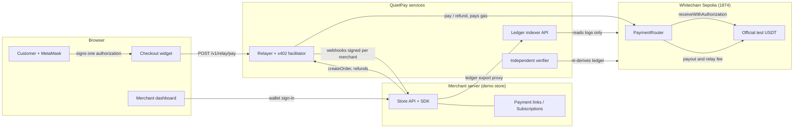
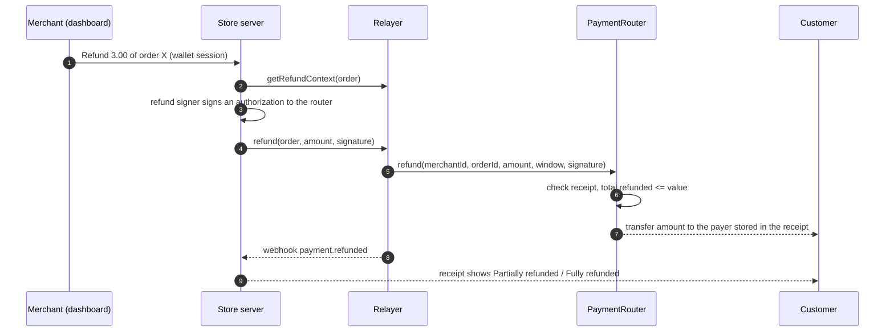
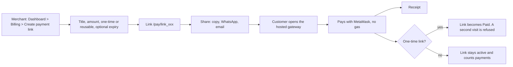
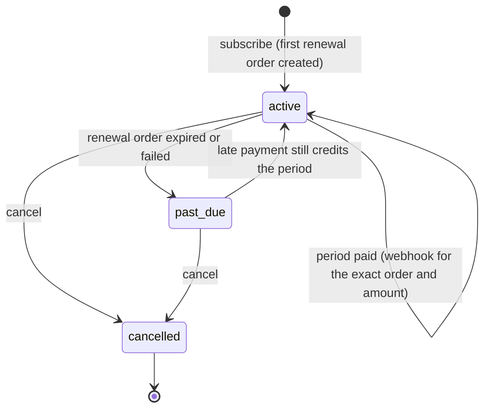
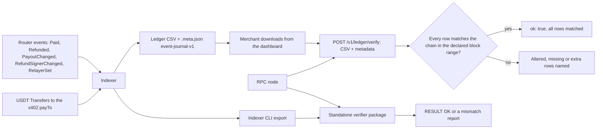

# QuietPay

**Gasless USDT checkout for Whitechain.** The customer signs once and never holds gas or sends a transaction. A relayer
submits the payment to an on-chain router that pays the merchant and the relay fee in one atomic step. Merchants get
hosted payment links, subscriptions, refunds, an on-chain ledger they can verify independently, and an SDK. AI agents
can pay for APIs over x402.

Built for ETHGlobal Mumbai 2026 (Whitechain: Operate and Scale tracks). **Testnet only. Not audited.**

**Read next:** [Whitepaper](whitepaper.md) · [SDK guide](docs/sdk/README.md) · [API reference](docs/sdk/api-reference.md) ·
[Widget](docs/sdk/widget.md) · [Feedback for the Whitechain team](WHITECHAIN_FEEDBACK.md)

---

## Contents

1. [What you get](#what-you-get)
2. [Live status and evidence](#live-status-and-evidence)
3. [Architecture](#architecture)
4. [How each flow works](#how-each-flow-works) (checkout, refund, payment link, subscription, x402, ledger)
5. [Repository layout](#repository-layout)
6. [Run it locally](#run-it-locally)
7. [Use the SDK](#use-the-sdk)
8. [Configuration](#configuration)
9. [Security model and testing](#security-model-and-testing)
10. [Limitations](#limitations)
11. [Roadmap](#roadmap)
12. [Documentation index](#documentation-index)

---

## What you get

| For | Feature |
| --- | --- |
| **Customers** | Pay in USDT with MetaMask. One signature, no gas, no transaction to send. A receipt page that also shows refund status. |
| **Merchants** | Hosted **payment links** (no website needed), one-time and reusable. A dashboard with revenue, refunds, customers, funnel, subscriptions and network gas covered. Partial and full **refunds**. **CSV exports**: transactions (optionally with gas) and an on-chain ledger. Wallet sign-in with MetaMask. |
| **Developers** | A server SDK (`createQuietPay`) where you choose `product`, `subscription` or `both` at start-up. A checkout widget (React or web component). Signed webhooks. A reference store. |
| **Agents** | x402 paid APIs: an agent pays per call with a signed authorization, the facilitator pays the gas. |
| **Auditors** | An indexer that rebuilds the ledger from chain logs, a verify call that checks a downloaded export against the chain, and a standalone verifier for the indexer's CLI export. |

---

## Live status and evidence

QuietPay targets the official Whitechain test USDT `0xcedfB56113143d55b2358b8CFbB0dEB5Ad2f55a7` on chain 1874 only.
The demo uses no other token, never mints one, and never fakes funding on the public testnet.

| Item | Status | Evidence |
| --- | --- | --- |
| PaymentRouter deployed and verified | **Done** (block 12351795) | [router](https://explorer.testnet.whitechain.io/address/0xb9D475cdd817900B45C356169c6FdC379B942d82), [deploy tx](https://explorer.testnet.whitechain.io/tx/0xb2ce9853989c79207659f2c7aac30d165a4b152e84c2f76c265342273ea3c4fa) |
| Official-USDT payment, zero-gas payer | **Done**: 1 USDT, fee 0.05, block 12361192 | [pay tx](https://explorer.testnet.whitechain.io/tx/0x1f2da1062f4c941382d1f0d3c7134c49858662d8eb3a68436b8f88fc7d892384), `docs/lead/live-usdt.md` |
| Official-USDT refund, on-chain | **Done**: 0.5 USDT back to the payer | [refund tx](https://explorer.testnet.whitechain.io/tx/0x1ac62248eb3def54499896fd8bfc197436fcb83d9544fe94432c138c2d85127d), `docs/lead/refund.md` |
| Browser checkout with a wallet | **Done** in Chromium with a MetaMask-style injected wallet that signs with real keys: pay, merchant wallet sign-in, partial and full refund, receipt | `deploy/browser-e2e-real.mjs` |
| Payment link end to end | **Done**: merchant creates a 1 USDT link, customer pays, link shows Paid, second visit refused | `deploy/browser-paylink-real.mjs` |
| Subscription end to end | **Done**: 1 USDT per month plan, first period paid, status Active, dashboard shows MRR | `deploy/browser-subscription-real.mjs` |
| x402 agent payments | **Done**: two paid calls (0.01 and 0.02 USDT), the payer sent zero transactions | [quote tx](https://explorer.testnet.whitechain.io/tx/0xff8982448111b5cf95e738eaa10646c8ef090f91640e29320b52ed61047cf88a), [signal tx](https://explorer.testnet.whitechain.io/tx/0xd172e25a0cbac4a738d463047b4d765dd32bee0a8043182ca10a1c4bda9bd8f1), `docs/b/build/x402-live.md` |
| Ledger export and verification | **Done**: the dashboard download (27 rows at the last check) verified against the chain through the ledger service, and a changed amount was caught; the standalone verifier returned RESULT OK on a CLI export of the live chain (17 rows rebuilt from 40 events) | `docs/lead/ledger.md`, `docs/lead/verifier.md`, `deploy/browser-ledger-check.mjs` |
| Hosted relayer | **Not done**: runs locally; `render.yaml` is ready (set `TRUST_PROXY_HOPS=1` behind a proxy, keep `0` without one) | |
| Real MetaMask extension UI | **Not automated**: tests inject a wallet with the same signing methods | |

Test counts at the last full run: shared 288, relayer 584, SDK 116, demo store 216, dashboard 121, indexer 91,
facilitator 205, paid API 51, widget 166, plus the Foundry suite for the router (`forge test`).

---

## Architecture



The browser never sees an API key. The store server holds the merchant API key and talks to the relayer. The relayer is
the only party that sends transactions and pays gas.

---

## How each flow works

### One-time checkout

```mermaid
sequenceDiagram
  autonumber
  participant C as Customer (MetaMask)
  participant W as Widget
  participant S as Store server
  participant R as Relayer
  participant P as PaymentRouter
  participant U as USDT

  C->>S: Pay (cart)
  S->>S: Price the cart on the server
  S->>R: createOrder(amount, reference)
  R-->>S: order (id, checkout params)
  S-->>W: orderId, amount, payout (pinned)
  W->>R: read order, verify chain, token, router, nonce locally
  W->>C: show amount, payout, fee; ask for ONE signature
  C-->>W: EIP-712 ReceiveWithAuthorization
  W->>R: POST /v1/relay/pay (signature)
  R->>R: guards, simulation, loss budget
  R->>P: pay(merchantId, orderId, payer, value, fee, window, signature)
  P->>U: receiveWithAuthorization (pulls value)
  P->>U: transfer value - fee to merchant payout
  P->>U: transfer fee to relayer
  P-->>R: Paid event
  R-->>S: signed webhook payment.settled
  S->>R: re-read order, require settled and same amount
  S-->>C: receipt page
```

What makes it safe: the nonce the customer signs is `keccak256(PAY_TAG, merchantId, orderId, payout, value, fee)`.
Changing the payout, amount, fee or order id makes the signature invalid. `receiveWithAuthorization` can only be
submitted by the router itself, so nobody else can replay the signature. One receipt exists per (merchant, order).

### Refund



The refund goes to the payer address recorded in the receipt, never to an address the merchant supplies. The relay fee is
not returned on a refund, so a fully refunded order leaves the merchant out of the fee (shown as negative net revenue).

### Payment link (no website needed)



Each visit to a link creates a new order with reference `link:<id>:<n>`. The link is credited only by a verified
webhook for that exact order and amount. If two customers somehow both pay a one-time link, the second payment is
recorded as a duplicate so the merchant can refund it.

### Subscription (pay per period)



An EIP-3009 authorization moves one exact amount once, so nothing can be pulled from a customer later. Each period the
SDK creates a renewal order, the customer signs it (still gasless), and the period counts only after a verified
webhook. A scheduled job calls `sweep()` and then `due()` to find subscriptions that need a new renewal order.

### x402 paid APIs for agents

```mermaid
sequenceDiagram
  autonumber
  participant A as Agent
  participant API as Paid API
  participant F as Facilitator
  participant U as USDT

  A->>API: GET /v1/quote
  API-->>A: 402 + PAYMENT-REQUIRED (price, payTo, network, asset)
  A->>A: check origin, payTo and budget; sign TransferWithAuthorization
  A->>API: retry with PAYMENT-SIGNATURE
  API->>F: settle
  F->>U: transferWithAuthorization (facilitator pays gas)
  U-->>F: confirmed
  F-->>API: settled (transaction hash)
  API-->>A: 200 + data + PAYMENT-RESPONSE
```

The agent holds no usable gas token and sends no transaction. Settlement is idempotent: a retry reuses the same signed
payload, never a new payment.

### Ledger and independent verification



There are two checks, for two file layouts:

- **Dashboard download** (layout `event-journal-v1`): send the CSV and its metadata to the ledger service's
  `POST /v1/ledger/verify` (merchant API key). It re-reads the logs for the exported block range and names every altered,
  missing or extra row. Reading about 70,000 blocks takes about a minute.
- **Standalone verifier** (`packages/verifier`, command in `docs/lead/verifier.md`): an independent program that does not
  use the indexer's code or database. It checks the file written by the indexer CLI (`export --from N --to M`), a
  different layout from the dashboard download.

Both read chain data only. Neither reads the relayer's database, so anyone can recompute the same file from the same
blocks.

---

## Repository layout

| Path | What it is |
| --- | --- |
| `contracts/` | `PaymentRouter` (Solidity 0.8.24, Foundry), deploy scripts, tests, `deployments.json` |
| `packages/shared` | Zod schemas, error codes, typed-data builders, fixtures, mock relayer, token facts, generated ABI |
| `packages/relayer` | Fastify relayer: order issuing, guards, nonce manager, SQLite, reconciliation, signed webhooks, refunds |
| `packages/facilitator` | The relayer plus x402 settlement routes (a combined process) |
| `packages/merchant-sdk` | `createQuietPay` (one-time, links, subscriptions), orders, refunds, webhooks, `paywall()` |
| `packages/widget` | `<quietpay-checkout>` web component and React wrapper, MetaMask signing |
| `packages/agent-client` | x402 buyer client with budgets and crash-safe persistence |
| `packages/indexer` | Event indexer, ledger CSV export, merchant ledger HTTP API |
| `packages/verifier` | Independent ledger verifier |
| `packages/e2e` | End-to-end helpers |
| `apps/demo-store` | Landing page, shop, hosted checkout, payment link pages, store server (the reference integration) |
| `apps/merchant-dashboard` | Merchant dashboard: overview, analytics, transactions, refunds, billing, exports |
| `apps/paid-api` | Demo x402 resources (`/v1/quote`, `/v1/signal`) |
| `apps/agent-demo` | Scripted paying agent |
| `deploy/` | `dev-stack.mjs` launcher, browser checks, Render files |
| `docs/` | `sdk/` developer docs, `lead/`, `a/`, `b/` build and review notes |

---

## Run it locally

Requirements: Node 20 or newer, pnpm 10, Foundry (for the contract tests). A funded test setup on Whitechain Sepolia
for live runs (see the safety rules below).

```sh
pnpm install
pnpm -r typecheck
pnpm -r test                                        # all packages
cd contracts && forge install && forge test         # router tests (fork test skips offline)
```

**Run the whole demo against the real testnet.** Create a gitignored `.env.local` from `.env.example` and fill in your
own values (RPC, relayer key, operator token, webhook secret, merchant API key, payout address, refund signer key).
Never commit it.

```sh
node --env-file=.env.local deploy/dev-stack.mjs            # add --fresh to start with empty state
```

| URL | What |
| --- | --- |
| http://localhost:5173 | Store (customers), payment links at `/pay/<id>`, subscriptions at `/subscribe/<id>` |
| http://localhost:5174 | Merchant dashboard (sign in with MetaMask using an allowed wallet) |
| http://127.0.0.1:3001 | Store API |
| http://127.0.0.1:8790 | Relayer and x402 facilitator |
| http://127.0.0.1:8788 | Ledger API (the first start reads the chain, about a minute) |
| http://127.0.0.1:8791 | Paid API (x402) |

The launcher keeps orders, subscriptions and links between restarts in a temp folder. Only processes it started are
stopped when you press Ctrl+C.

**Browser checks** (they drive Chromium with an injected wallet; set `CHROME_PATH` if Playwright's own browser build
differs): `deploy/browser-check.mjs` (no spend), `deploy/browser-ledger-check.mjs` (no spend),
`deploy/browser-e2e-real.mjs`, `deploy/browser-subscription-real.mjs` and `deploy/browser-paylink-real.mjs` (these
spend small amounts of test USDT).

**Safety rules for live runs:** official test USDT only; at most 2 USDT per payment and 10 USDT per run; the payer must
be unable to pay gas; keys only in the gitignored env file.

---

## Use the SDK

```ts
import { createQuietPay } from "@quietpay/merchant-sdk";

// One line of setup. Reads QUIETPAY_BASE_URL, QUIETPAY_API_KEY, QUIETPAY_MERCHANT_ID and QUIETPAY_WEBHOOK_SECRET.
const qp = createQuietPay({ billing: "both" });     // "product" | "subscription" | "both"

const order = await qp.createOrder({ amount: "8500000" });                       // 8.50 USDT, one-time
const link  = await qp.links.create({ title: "Logo design", amount: "1000000" }); // payment link
const plan  = await qp.subscriptions.createPlan({ name: "Pro", amount: "5000000", interval: "month" });
```

Show the widget in the browser with the order id and pin the amount and payout your server computed:

```html
<quietpay-checkout order-id="0x..." relayer-url="https://your-relayer" expected-amount="8.5" expected-payout="0x..."></quietpay-checkout>
```

The complete server (checkout endpoint plus verified webhook) fits in 20 lines: [apps/demo-store/server/quickstart.ts](apps/demo-store/server/quickstart.ts). Full guide with webhooks, refunds, subscriptions, x402, errors and a security checklist: [docs/sdk/README.md](docs/sdk/README.md).

---

## Configuration

The most important settings (full list in `packages/relayer/src/config.ts` and `docs/b/build/config-matrix.md`).

| Variable | Used by | Meaning | Default |
| --- | --- | --- | --- |
| `RPC_URL` | all | Whitechain Sepolia RPC (`https://rpc.testnet.whitechain.io`) | required |
| `ROUTER_ADDRESS`, `USDT_ADDRESS` | relayer, indexer | must be the qualifying router and the official USDT | from `deployments.json` |
| `RELAYER_PRIVATE_KEY` | relayer | wallet that sends transactions and pays gas | required |
| `RELAY_FEE_USDT` | relayer | flat relay fee per payment | `0.05` |
| `LOSS_BUDGET_WBT_PER_HOUR` | relayer | cap on gas lost to reverted transactions | `0.05` |
| `PAYER_CAP_USDT` | relayer | per-payer spend cap in a 24 hour window | `100` |
| `RATE_LIMIT_PER_MINUTE` | relayer | per-IP request limit | `20` |
| `ORDERS_PER_MINUTE_PER_MERCHANT` | relayer | per-merchant order creation limit | `1200` |
| `MERCHANT_API_KEYS` | relayer, indexer | `key:merchantId` pairs | required |
| `WEBHOOK_SECRET` | relayer | master secret; each merchant gets an HMAC-derived secret | required |
| `QUIETPAY_BILLING` | store | `product` / `one_time`, `subscription`, or `both` | `both` |
| `QUIETPAY_MERCHANT_WALLETS` | store | wallets allowed to sign in to the dashboard | the payout address |
| `QUIETPAY_LEDGER_URL` | store | ledger API for CSV downloads | unset (downloads answer 503) |
| `QUIETPAY_SUBSCRIPTIONS_FILE`, `QUIETPAY_PAYMENT_LINKS_FILE` | store | JSON stores for subscriptions and links | in memory |
| `INDEXER_FROM_BLOCK`, `INDEXER_CONFIRMATIONS`, `INDEXER_PORT`, `INDEXER_HOST` | indexer | start block, confirmations (2), port (8788), bind address | |

---

## Security model and testing

- **Who can do what.** The payer signs one authorization that fixes the payout, amount, fee and order. The relayer can
  refuse service or pause, but cannot redirect funds or exceed the merchant's fee cap. The router owner is trusted
  (see limitations).
- **Relayer guards.** Server-issued order ids and amounts only, signature checked against the order, simulation before
  broadcast, a persisted hourly gas loss budget, per-payer caps and revert limits, a signed-transaction journal with a
  `broadcast_unknown` state so an ambiguous send is never treated as unsent, reconciliation of pending transactions,
  per-merchant webhook secrets, and webhook delivery that blocks internal addresses.
- **Merchant access.** Wallet sign-in uses a single-use challenge (EIP-4361 style) and a session token stored as a hash,
  with an allow-list of wallets. The merchant API key never reaches a browser.
- **Method.** Tests first (unit, integration, feature, attack tests), then adversarial test rounds written as failing
  exploit tests and fixed, repeated until clean. Round notes: `docs/lead/pentest-round-1.md`, `docs/lead/attack-log.md`,
  `docs/b/attack-log.md`. **There has been no external human audit.**

---

## Limitations

Read these before relying on anything here.

**Scope and maturity**
- Testnet only, official test USDT only. The contracts and services are not audited. No fiat conversion, custody or
  compliance (KYC, tax, receipts for accounting) is provided.
- The relayer runs locally. There is no hosted, highly available deployment, and one relayer process must own one signing
  key and one database. The in-memory rate limiter resets on restart.
- The real MetaMask extension UI is not automated in tests, only an injected wallet with the same methods.

**Trust**
- **The router owner is trusted.** It is a deployer key in this MVP, not a cold or multi-signature key. The owner can
  change a merchant's payout address instantly with no merchant consent and no timelock (future payments then go to the
  new address), rotate a merchant's refund signer, allow or remove relayers, and pause the router. It cannot move funds
  after a payer has signed, and a pause only lets signed authorizations expire. A production router needs a timelock or
  merchant-signed payout changes and a cold owner key.
- **The relayer is a trusted gas sponsor.** It can censor or pause. It cannot redirect funds.
- **The price is not bound on-chain.** The payer signs a value for an order id. Protection lives in the relayer, which
  only relays orders it issued and rejects any other amount, plus random 32-byte order ids.
- **The test USDT is a proxy** whose admin can pause it or blacklist addresses. A router payment then reverts.
- The fee recipient is `msg.sender`: another allow-listed relayer could front-run a signature and take the fee. The
  payer and merchant are unaffected.

**Payments**
- A relay fee (0.05 USDT) is not returned on a refund, so `net revenue` can be negative after a full refund. The flat
  fee is not market pricing.
- The relayer pays gas on refunds and x402 settlements.
- Tokens sent directly to the router are not supported and cannot be recovered.
- **Subscriptions are not automatic.** Each period needs the customer to sign again (a reminder or pay link must be sent).
  Subscriptions and payment links keep their state in a JSON file in the demo store; use the SDK's store interface (with
  compare-and-set) for a database in production.
- Renewal orders live at most 24 hours. After that a subscription is `past_due` and a new renewal is created.
- Churn can only be reported all-time: cancellation dates are not recorded.
- A wrong payment to a paid one-time link is recorded as a duplicate for manual refund, not refunded automatically.

**x402 and agents**
- After a payment settles, the signed authorization is public calldata, so anyone can rebuild the payment header and
  obtain the resource before the payer's own retry if delivery is still pending. EIP-3009 cannot bind the requester.
  Mitigations: short settlement wait, a delivery-attempt cap, lease tokens, nothing delivered before settlement.
- A bare USDT transfer to the pay-to address (without the facilitator) is recorded as a deposit, not as proof of an agent
  payment.
- Parallel x402 sends from one wallet before a revert is mined can each pass the per-wallet check; the global loss budget
  is the backstop.
- The official x402 client libraries refuse the custom chain and token unless the integrator adds an `allowedAssets`
  entry. Our own agent client was used for the live payments.
- The agent demo proves gaslessness by an unchanged native balance and transaction count, and needs a payer with less WBT
  than one transfer costs.

**Ledger and verification**
- The two ledger layouts are not unified: the standalone verifier does not accept the dashboard download (its statuses and `x402` source are different), and the ledger service's verify call uses the indexer's own chain reader rather than independent code.
- The verifier proves consistency with chain data inside a declared range, as served by the RPC node(s) given. It does
  not prove completeness outside that range; pass `--from`, `--to` and `--min-confirmations` and compare its checkpoint
  out of band. `--rpc2` cross-checks ledger logs only.
- The ledger download is limited (block range, response size, 20 requests per minute per session).

**Browser and wallets**
- The widget also contains a demo payer key (AES-GCM in IndexedDB) for the no-wallet demo. It is not a wallet and not
  production custody. Any script on the same origin can reach the widget's signing account. Use MetaMask for real use.
- Wallets show the 32-byte nonce for EIP-712 typed data; consent depends on the widget showing the amount, payout and fee
  first (it does, and it verifies the order against the router before asking for a signature).

**Tooling and dependencies**
- Dependency advisories remain open for major-version upgrades (zod 3 to 4, fastify, vitest). Request bodies are capped at
  16 KiB as a mitigation. See `docs/b/blocked.md` and `docs/lead/blocked.md`.
- CI pins actions by tag rather than commit hash and uses the current Foundry toolchain.

---

## Roadmap

1. Hosted, highly available relayer with a shared nonce lock, and a managed database.
2. A new router with a timelocked or multi-signature owner, merchant-signed payout changes, and an on-chain quote the
   merchant signs so the price is bound on-chain.
3. An external security audit, then mainnet with the production stable-coin.
4. Automatic recurring billing using a spending permission (for example a smart-account session key), so the customer
   signs once per subscription instead of once per period.
5. Cancellation dates and cohort analytics, webhook dashboards, and refunds triggered from webhooks.
6. x402 support in common client libraries for `eip155:1874`, and a delivery token that binds the requester.

---

## Documentation index

| Document | What it covers |
| --- | --- |
| [whitepaper.md](whitepaper.md) | The design: protocol, security model, economics, evidence, limits |
| [docs/sdk/README.md](docs/sdk/README.md) | Developer guide: install, quick start, billing models, links, subscriptions, refunds, webhooks, x402, errors |
| [docs/sdk/api-reference.md](docs/sdk/api-reference.md) | Every exported function and type |
| [docs/sdk/widget.md](docs/sdk/widget.md) | The checkout widget |
| [WHITECHAIN_FEEDBACK.md](WHITECHAIN_FEEDBACK.md) | Feedback for the Whitechain team |
| `docs/lead/` | Token gate, deployment, ledger, verifier, refunds, review rounds |
| `docs/b/` | Backend build notes, x402, quickstart, route matrix, attack logs |
| `docs/a/` | Frontend notes and limitations |
