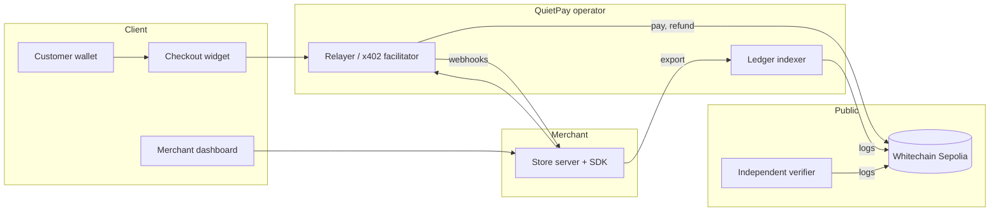

# QuietPay: gasless stablecoin checkout with an auditable ledger

Version 1.0, 2026-11-07. Status: working testnet system on Whitechain Sepolia (chain 1874). Not audited.

## Abstract

Paying with a stablecoin today asks a customer to hold a second asset (the chain's gas token), approve a spending
allowance, send a transaction, and wait. Most customers do not have the gas token, and most merchants cannot onboard
them to one. QuietPay removes that step. The customer signs one message in their wallet. A relayer submits the payment
to an on-chain router, which pulls the exact amount from the customer, pays the merchant, pays the relay fee, and
records a receipt, all in one atomic transaction. The customer's signature commits to the merchant payout, the amount,
the fee and the order, so the relayer can neither redirect nor inflate the payment.

On top of this core, QuietPay gives merchants hosted payment links (so a business without a website can get paid), per-period
subscriptions, partial and full refunds, a merchant dashboard, and an exported ledger that an independent verifier can
re-derive from chain data alone. The same primitive lets AI agents pay for HTTP APIs per call (x402). The system runs
on the Whitechain Sepolia testnet with the official test USDT, and has settled real payments, refunds, a subscription
period, a payment link and two agent payments there.

## 1. The problem

1. **Gas friction.** A buyer with USDT and no gas token cannot pay. Asking them to acquire one loses most checkouts.
2. **Allowances are blank cheques.** The usual "approve then pay" flow gives a contract a standing right to spend the
   buyer's tokens, which many wallets and users distrust.
3. **Opaque terms.** A buyer approving a transaction cannot easily confirm who gets paid, how much, and what fee the
   sponsor takes. A sponsor that pays gas could, in a naive design, change those terms.
4. **Unverifiable books.** A merchant's payment records come from the processor's database. The merchant, and any
   accountant or counterparty, must trust it.
5. **No simple path for small merchants.** A new business with no website and no developer cannot accept stablecoin
   payments without building a checkout.
6. **Agents cannot pay.** Machine clients that call paid APIs need a way to pay per request without human approval and
   without holding gas.

## 2. Design goals

- The payer signs once and pays no gas, ever.
- The payer's signature fixes every term that matters: merchant payout, amount, fee, order, and expiry.
- A relayer is a service provider, not a custodian. It can refuse service. It cannot take funds or change terms.
- Settlement, fee and receipt happen atomically, so there is no state where the merchant is unpaid but the buyer charged.
- The merchant's ledger can be rebuilt by anyone from public chain data and checked against the merchant's export.
- Small merchants can be paid with a link, with no site and no code.
- Use the token's own signature standard (EIP-3009) instead of new token contracts or allowances.

## 3. System overview



Components:

| Component | Role |
| --- | --- |
| **PaymentRouter** (Solidity) | Holds the merchant registry and relayer allow-list; executes `pay` and `refund`; stores receipts |
| **Relayer** | Issues orders, validates signed payments, simulates, broadcasts, tracks, reconciles, sends signed webhooks |
| **Facilitator** | The same process, extended with x402 settlement for agents |
| **Merchant SDK** | Orders, refunds, webhooks, payment links, subscriptions, `paywall()` |
| **Widget** | Browser component that verifies the order and asks the wallet for one signature |
| **Indexer + verifier** | Build and independently check the ledger from chain logs |
| **Dashboard** | Wallet sign-in, revenue and customer analytics, refunds, links, subscriptions, exports |

## 4. The payment protocol

### 4.1 Building block: EIP-3009

The official test USDT implements EIP-3009 `receiveWithAuthorization(from, to, value, validAfter, validBefore, nonce,
v, r, s)`. The holder signs a typed message authorizing a transfer to a specific `to`. Two properties are used:

- The authorization is a one-time instruction with an expiry window, not an allowance.
- `receiveWithAuthorization` requires that the caller is the `to` address in the signature. If `to` is the router, only
  the router can redeem it, so no third party can submit the signature on their own or front-run it.

### 4.2 Binding the terms into the nonce

EIP-3009 lets the signer choose the 32-byte nonce. QuietPay derives it from the terms:

```text
nonce = keccak256(abi.encode(PAY_TAG, merchantId, orderId, payout, value, fee))
PAY_TAG = keccak256("quietpay.pay.v2")
```

The router recomputes this nonce from the arguments the relayer passes and from the merchant's registered payout. If the
relayer changes the payout, the amount, the fee or the order id, the recomputed nonce differs from the one the payer
signed, the token rejects the signature, and the transaction reverts. The payer's wallet therefore enforces the terms
without any trust in the relayer.

### 4.3 `pay`

```mermaid
sequenceDiagram
  participant R as Relayer (allow-listed)
  participant P as PaymentRouter
  participant U as USDT
  participant M as Merchant payout
  R->>P: pay(merchantId, orderId, payer, value, fee, validAfter, validBefore, signature)
  P->>P: caller is an allowed relayer; merchant exists; value > 0
  P->>P: fee <= merchant cap and fee < value; window valid and <= 10 min
  P->>P: receipt for (merchant, order) must not exist
  P->>P: write receipt (effects before interactions)
  P->>U: receiveWithAuthorization(payer -> router, value, nonce)
  P->>P: balance increased by exactly value, else revert
  P->>U: transfer(value - fee) to merchant payout
  P->>U: transfer(fee) to the relayer
  P-->>R: emit Paid(merchantId, orderId, payer, payout, value, fee, relayer)
```

Checks in the contract: relayer allow-list, registered merchant, non-zero payer and value, `fee <= maxRelayFee` and
`fee < value`, signature length 65, validity window of at most 10 minutes that has started and not expired, a single
receipt per `(merchantId, orderId)`, reentrancy guard, pause switch, and a balance-delta check that refuses
fee-on-transfer or otherwise lossy tokens. The receipt is written before any token moves.

### 4.4 `refund`

The merchant registers a **refund signer** key. To refund, that key signs a `receiveWithAuthorization` for `amount`
to the router; the relayer submits it; the router pulls the funds from the refund signer and forwards them to the
**payer stored in the receipt**.

```text
refundNonce = keccak256(abi.encode(REFUND_TAG, merchantId, orderId, payer, amount, refundIndex))
REFUND_TAG = keccak256("quietpay.refund.v1")
```

The destination is never an argument, so a merchant, relayer or attacker cannot send a refund anywhere but the original
payer. The router tracks `totalRefunded` and `refundCount` and refuses refunds above the paid value. Partial refunds are
supported. The relay fee is not returned.

### 4.5 Registry and administration

The owner registers merchants (payout, refund signer, fee cap), changes a payout (`setPayout`), rotates a refund signer
(`setRefundSigner`, emits `RefundSignerChanged`), allows or removes relayers, and can pause. These powers are why the
owner is a trusted party in this version (section 9).

## 5. The relayer

The relayer is an HTTP service backed by SQLite. It is the only component that sends transactions and pays gas.

**Orders.** A merchant (authenticated by API key) creates an order for an amount. The relayer returns random 32-byte
order id and the exact typed data to sign. Only orders the relayer issued can be paid, and the amount in the signature is
checked against the order.

**Guards before spending gas.** Per-IP and per-merchant rate limits; a per-payer spend cap in a 24 hour window
(default 100 USDT); a minimum time left on the signature (60 s); simulation of the exact call before broadcast;
per-payer and per-order revert limits; a persisted hourly loss budget for gas lost to reverted transactions (default
0.05 WBT per hour) with a per-payer share; limits on new payers per IP. Signatures with very short windows are refused
because a payer could otherwise make the relayer pay for transactions that revert.

**Reliable broadcast.** A transaction is signed locally, its raw bytes and hash are written to the database, and only
then is it sent. If the network call times out, the order enters a `broadcast_unknown` state and is never released as
unpaid until the hash is found or the nonce is shown to be used by something else. A reconciliation loop (30 s) handles
receipts, replaced or dropped nonces, one resend, and then failure. Status changes are compare-and-set, so concurrent
paths cannot swallow a webhook or mark a paid order expired.

**Webhooks.** Each merchant has its own signing secret derived by HMAC from a master secret and the merchant id.
Deliveries retry on a schedule (5 s up to 2 h, seven attempts), refuse internal and metadata addresses, pin the resolved
address, and do not follow redirects. Receivers verify the signature over the raw body, re-read the order from the relayer,
and process each event id once.

**Fee.** A flat relay fee (default 0.05 USDT) is signed by the payer and paid to the relayer by the router. The merchant
cap is enforced on-chain.

## 6. Merchant products

### 6.1 Hosted payment links

A merchant creates a link in the dashboard (title, amount, one-time or reusable, optional expiry) and shares it. The link
opens a hosted gateway page. Each visit creates an order with reference `link:<id>:<n>`; the link is credited only by a
verified webhook for that exact order and amount. A one-time link becomes paid after the first payment, and a second
payment is recorded for manual refund instead of being credited. A merchant needs no website and no code.

### 6.2 Subscriptions

Because an EIP-3009 authorization moves one exact amount once, nothing can be pulled from the customer later. QuietPay
therefore bills per period: each period the SDK creates a renewal order for the plan amount and the customer signs it.
A period counts as paid only after a verified webhook for the exact order and amount. A late payment after a failure
notice still credits the period; the renewal window is at most 24 hours, after which the subscription is `past_due`.
Billing days are anchored so that a plan starting on the 31st does not drift. The merchant chooses at SDK start-up whether
to offer `product`, `subscription` or `both`, and calls for a disabled model fail with a clear error.

### 6.3 Refunds, dashboard and exports

The dashboard signs the merchant in with a wallet challenge (a single-use message, EIP-4361 style) against an allow-list,
issues a session token stored as a hash, and offers refunds, customer analytics (growth against the previous period,
revenue mix, repeat customers, checkout funnel, refund rate, confirmation speed, when customers pay, unit economics,
subscription health) and exports: a transactions CSV (optionally with the gas the relayer paid per order) with protection
against spreadsheet formula injection, and the on-chain ledger.

## 7. Agent payments (x402)

An API replies `402 Payment Required` with its price, recipient, network and asset. The agent checks that the origin and
recipient are on its allow-list and that the price fits its per-call limit and session budget, signs an EIP-3009
`transferWithAuthorization` with a fresh random nonce, and retries with the signature. The paid API asks the facilitator
to settle; the facilitator submits the transfer and pays the gas; the API returns the data only after confirmed
settlement. The agent needs no gas token and sends no transaction. The agent client persists its intent, signature and
submission in an integrity-checked journal, so a crash never produces a second payment for the same call.

## 8. The auditable ledger

The indexer reads router events (`Paid`, `Refunded`, `PayoutChanged`, `RefundSignerChanged`, `RelayerSet`) and USDT
transfers to the x402 pay-to address, in bounded chunks committed together with a cursor and a block hash (a reorg is
detected, not ignored). It writes an event-journal CSV and a metadata file naming the chain, router, token, block range,
confirmations and a hash of the event set. Net revenue per row is `value - fee - refunded`, which is negative after a full
refund because the fee is kept.

The **verifier** is a separate program that does not read the indexer's database or the relayer. Given the CSV, its
metadata and an RPC (optionally a second one), it re-reads the logs for the declared range and checks every row and the
event-set hash. It applies the same qualification guard (official token, qualifying router). Its result is a statement
of consistency with chain data for that range, not a proof of completeness outside it.

## 9. Security model

**Assumptions.** The token implements EIP-3009 correctly. The chain is live and final after the configured confirmations.
The merchant keeps its refund-signer key and API key private.

| Actor | Can | Cannot |
| --- | --- | --- |
| Payer | Pay, with the terms fixed by their signature | Pay less than the order or pay a different merchant |
| Relayer | Refuse, delay, censor, pause its own service; take the signed fee | Change payout, amount, fee or order; spend more than the payer signed; redirect refunds |
| Another relayer | Front-run a signature and earn the fee (if allow-listed) | Change anything else |
| Merchant | Refund up to the paid value to the original payer | Send a refund to a different address; refund more than paid |
| Router owner | Change a merchant payout for **future** payments, rotate refund signers, change relayers, pause | Move funds after a payer has signed; a pause only lets signed authorizations expire |
| Token admin | Pause the token or block addresses (then payments revert) | |
| Anyone | Read the chain and verify the ledger | Submit someone else's authorization to the router |

**Threats considered and where they are handled.**

| Threat | Handling |
| --- | --- |
| Relayer tampers with terms | Terms are in the signed nonce; the token rejects a mismatch |
| Signature replay or front-run | `receiveWithAuthorization` is redeemable only by the router; one receipt per order; nonce is single-use |
| Wrong amount for an order | Relayer signs against the issued order only; widget pins amount and payout from the merchant server |
| Malicious or buggy relayer response to the widget | Widget verifies chain, token, router and recomputes the nonce before asking for a signature |
| Gas griefing (many reverting payments) | Minimum signature lifetime, simulation, revert limits, hourly loss budget |
| Ambiguous broadcast (timeout) | Signed-transaction journal and `broadcast_unknown` state |
| Webhook SSRF | Blocked address ranges, pinned resolution, no redirects, per-merchant secrets |
| Forged webhook credits a link or subscription | Credit only for the exact issued order id and amount, after signature verification |
| Double charge on a subscription period | One order per period under a lock; a late payment of an earlier order of the same period still credits it once; extras are recorded |
| Spreadsheet formula injection from free text | Cell escaping unless the whole value is numeric |
| Ledger tampering by the merchant | The verifier re-derives the ledger from chain logs |

**How it was tested.** Tests were written before code: unit, integration, feature and attack tests, including a Foundry
suite for the router (unit, invariants, fuzz, attack and fork tests). Adversarial rounds then wrote failing exploit tests
against each finished area, and each finding was fixed with a regression test. The relayer, SDK, store, dashboard and
shared packages run several hundred tests each. The router mutation sweep did not complete because the machine ran out of
memory, so **no claim of zero surviving mutants is made**. **There has been no external human audit.**

## 10. Economics

The merchant pays a flat relay fee per payment, set by the operator and capped per merchant on-chain (default 0.05 USDT).
The customer pays no fee and no gas. The relayer pays gas in the native token (WBT).

On the live testnet the relayer's recorded gas cost for a `pay` transaction averaged about 0.0013 WBT. The fee covers that
cost as long as one WBT is worth less than about 39 USDT (0.05 / 0.0013). That figure is derived from a small sample and
testnet WBT has no market price, so it is an illustration, not a pricing claim. Refunds and x402 settlements carry no fee, so the
operator absorbs their gas. The fee is not returned on a refund, which is why a fully refunded order shows negative net
revenue for the merchant.

## 11. Evidence

All on Whitechain Sepolia, official test USDT `0xcedfB56113143d55b2358b8CFbB0dEB5Ad2f55a7`, router
`0xb9D475cdd817900B45C356169c6FdC379B942d82` (source verified, deployed in block 12351795).

| Event | Result | Transaction |
| --- | --- | --- |
| First checkout | 1 USDT, fee 0.05, merchant received 0.95, payer paid no gas | `0x1f2da106...d892384` (block 12361192) |
| Refund | 0.5 USDT returned to the payer | `0x1ac62248...c2d85127d` |
| Relayer-API checkout | 1 USDT settled | `0xd3872f54...0b149a6` |
| x402 payment | 0.01 USDT, the payer sent zero transactions | `0xff898244...47cf88a` |
| x402 payment | 0.02 USDT | `0xd172e25a...d8f1` |
| Browser runs | Wallet checkout, merchant wallet sign-in, partial and full refund, subscription period, payment link, ledger download | `deploy/browser-*.mjs` |

Full hashes and explorer links are in the README and in `docs/lead/live-usdt.md`. The recorded time from order creation to
settlement had a median of 6 seconds in a small sample.

## 12. Limitations

The README lists them in full. The ones that matter most:

- **Testnet and unaudited.** No claim is made about mainnet safety, regulation, tax or custody.
- **A trusted owner key.** The router owner can change a merchant's payout with no delay or consent for future payments.
- **A trusted relayer for availability.** It cannot take funds but it can stop service.
- **The price is not bound on-chain.** The relayer enforces it by issuing the order.
- **Subscriptions are per period,** because standard EIP-3009 cannot grant recurring pull rights.
- **x402 authorizations become public** after settlement and cannot bind the requester, so delivery relies on a short wait,
  lease tokens and attempt caps.
- **The verifier proves consistency in a declared range,** not completeness outside it.
- **Single relayer process and local deployment** in this version.
- **The test USDT admin** can pause the token or block addresses.

## 13. Roadmap

1. A hosted relayer with a shared nonce lock and a managed database, and a status page.
2. A new router: timelocked or multi-signature ownership, merchant-signed payout changes, and a merchant-signed quote so
   the price is bound on-chain.
3. An external audit, then mainnet with the production stable-coin.
4. Automatic recurring billing using a revocable spending permission such as a smart-account session key.
5. Cancellation dates, cohort analytics, webhook delivery dashboards, refunds triggered from webhooks.
6. x402 client support for `eip155:1874` and a delivery token that binds the requester.

## 14. Conclusion

A gasless checkout does not require trusting the party that pays the gas, because the buyer's signature can fix the
payout, the amount and the fee. QuietPay shows that design working with the official test USDT on Whitechain Sepolia: one
signature from the buyer, one atomic settlement, a receipt on chain, refunds that can only go back to the payer, links and
subscriptions for small merchants, agent payments over x402, and a ledger that anyone can re-derive from public data. What
remains before production is operational and governance work (hosting, owner key, audit), listed above, rather than a
change to the core idea.

## References

- EIP-3009: Transfer or Receive With Authorization.
- EIP-712: Typed structured data hashing and signing.
- EIP-4361: Sign-In with Ethereum (the dashboard login follows this message layout).
- x402 v2 HTTP transport and exact EVM scheme, <https://github.com/x402-foundation/x402>.
- Whitechain developer documentation, <https://docs.whitechain.io>.
- Project documents: `README.md`, `docs/sdk/README.md`, `docs/lead/*`, `docs/b/*`, `WHITECHAIN_FEEDBACK.md`.
